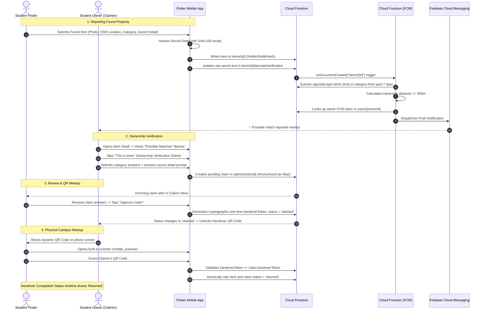

# 🧭 Finders Keepers — Campus Lost & Found Mobile App

A modern, institutional lost-and-found mobile application built specifically for campus environments (**VIT Vellore**), developed using **Flutter**, **Riverpod**, **Firebase Auth**, **Cloud Firestore** (offline persistence enabled), **Firebase Cloud Functions (FCM)**, and **flutter_map** (OpenStreetMap).

---

## 📋 Table of Contents
- [Architecture & Tech Stack](#-architecture--tech-stack)
- [Setup & Installation](#-setup--installation)
- [End-to-End Workflow Diagram (Mermaid)](#-end-to-end-workflow-diagram)
- [Firestore Database Schema](#-firestore-database-schema)
- [Ownership Verification Mechanism](#-ownership-verification-mechanism)
- [Smart Match & Spatial Notification Engine](#-smart-match--spatial-notification-engine)
- [Campus Lost Heatmap](#-campus-lost-heatmap)
- [Seeding Demo Campus Data](#-seeding-demo-campus-data)
- [Building the Release APK](#-building-the-release-apk)

---

## 🏗️ Architecture & Tech Stack

- **Framework**: Flutter 3.x (Dart 3.x) with Material 3 theming (Teal `#00897B` & Amber `#FFB300` palette, dark/light modes).
- **State Management**: Flutter Riverpod (`StateNotifierProvider`, `StreamProvider`, `FutureProvider`).
- **Institutional Auth**: Firebase Auth restricted strictly to `@vitstudent.ac.in` domain (Email/Password + Google Sign-In).
- **Database & Offline Sync**: Cloud Firestore with offline persistence enabled (`persistenceEnabled: true`), local drafts via `SharedPreferences`, and an auto-retrying upload queue with `connectivity_plus`.
- **Maps & Geolocation**: OpenStreetMap via `flutter_map` (zero proprietary API key dependencies), approximate coordinate privacy (~100m rounding), and campus landmark snapping.
- **Handovers**: QR generation via `qr_flutter` and camera-based validation via `mobile_scanner`.
- **Notifications**: Serverless Cloud Functions (TypeScript) triggered on Firestore document creation with FCM push notifications.

---

## 🚀 Setup & Installation

### 1. Prerequisites
- **Flutter SDK** (`>= 3.2.0`) installed and added to your system `PATH`.
- **Android SDK** with Android Studio and Platform Tools (API Level 34).
- **Node.js** (`>= 18.x`) and **npm** for Firebase Cloud Functions.
- **Firebase CLI** (`npm install -g firebase-tools`).

### 2. Clone & Install Flutter Dependencies
```bash
# Clone the repository
git clone https://github.com/dhruvil-modi/finders-keepers.git
cd finders-keepers

# Install Flutter dependencies
flutter pub get
```

### 3. Firebase Project Configuration
1. Create a Firebase project in the [Firebase Console](https://console.firebase.google.com/).
2. Enable **Authentication**:
   - Enable **Email/Password**.
   - Enable **Google Sign-In** with institutional domain restriction (`vitstudent.ac.in`).
3. Enable **Cloud Firestore** (Production or Test Mode).
4. Register your Android app with package name: `com.vit.finders_keepers`.
5. Download `google-services.json` and place it in:
   ```
   android/app/google-services.json
   ```
6. Deploy the strict security rules and compound indexes:
   ```bash
   firebase login
   firebase deploy --only firestore:rules,firestore:indexes
   ```

### 4. Deploy Cloud Functions (Smart Match FCM)
```bash
cd functions
npm install
npm run build
firebase deploy --only functions
```

---

## 🔄 End-to-End Workflow Diagram



---

## 🗄️ Firestore Database Schema

### 1. `items/{itemId}` (Public Item Document)
| Field | Type | Description |
|---|---|---|
| `id` | `String` (UUIDv4) | Unique item identifier. |
| `type` | `String` (`lost` \| `found`) | Whether item was lost or found. |
| `title` | `String` | Brief item title (e.g. "Space Grey MacBook Air M2"). |
| `category` | `String` | Category (`Electronics`, `Cards & IDs`, `Wallets`, etc.). |
| `description` | `String` | Public visual description. |
| `imageUrls` | `List<String>` | Firebase Storage download URLs. |
| `location` | `Map<String, dynamic>` | `{ latitude: double, longitude: double, label: String }`. |
| `status` | `String` (`lost` \| `found` \| `claimed` \| `returned`) | Current lifecycle state. |
| `ownerId` | `String` (UID) | Firebase Auth UID of the reporting student. |
| `hiddenDetailHash` | `String` (SHA-256) | Client-hashed secret for verification; empty for lost items. |
| `createdAt` | `Timestamp` | Item creation timestamp. |
| `isPendingSync` | `Boolean` | Client-only offline flag (false in Firestore). |

### 2. `items/{itemId}/private/verification` (Secured Subcollection)
*Protected by Firestore Security Rules: Only the item's original creator can read or write to this path.*
| Field | Type | Description |
|---|---|---|
| `hiddenDetail` | `String` | Plaintext private answer provided by the finder (e.g. "braided white cable with black ink dot"). |
| `updatedAt` | `Timestamp` | Creation / update timestamp. |

### 3. `claims/{claimId}` (Verification Claims Collection)
*Protected by Firestore Security Rules: Only the item's poster and the claimer can read.*
| Field | Type | Description |
|---|---|---|
| `id` | `String` (UUIDv4) | Unique claim identifier. |
| `itemId` | `String` (Foreign Key) | Reference to `items/{itemId}`. |
| `claimerId` | `String` (UID) | UID of the student claiming the item. |
| `claimerEmail` | `String` | Institutional email (restricted to internal verification). |
| `claimerName` | `String` | Display name of the claimer. |
| `claimerAlias` | `String` | Anonymized identifier displayed publicly (e.g., `VIT Student #A8F3`). |
| `answers` | `Map<String, String>` | Question-answer pairs covering category prompts + secret detail. |
| `status` | `String` (`pending` \| `approved` \| `rejected`) | State of finder's review. |
| `handoverToken` | `String` (Nullable) | Cryptographic single-use token generated upon approval. |
| `approvedAt` | `Timestamp` (Nullable) | Timestamp when finder approved the claim. |
| `returnedAt` | `Timestamp` (Nullable) | Timestamp when QR was scanned at physical meetup. |
| `createdAt` | `Timestamp` | Claim submission timestamp. |

### 4. `users/{userId}` (Student Profile & Device Registry)
| Field | Type | Description |
|---|---|---|
| `email` | `String` | Institutional email (`*@vitstudent.ac.in`). |
| `displayName` | `String` | Student full name. |
| `fcmToken` | `String` | Device FCM token for receiving Smart Match alerts. |
| `lastActive` | `Timestamp` | Last login or activity timestamp. |

---

## 🔐 Ownership Verification Mechanism

To prevent false claims, theft, and contact leakage, Finders Keepers uses a **zero-exposure 4-phase ownership verification protocol**:

### 1. The "Hidden Detail" Secret
When a student reports finding an item, they fill out visual attributes publicly, but provide one private secret in the **"Hidden Detail"** field (*"Only the real owner should know this"*).
- *Examples*: "Engraving inside ring says 'Always'", "Sticker on bottom lid is Octocat with sunglasses", "Lockscreen wallpaper is a cat wearing a chef hat".
- **Cryptographic Obfuscation**: The client calculates `sha256(secret.toLowerCase())` and stores only the hash on the public item document. The plaintext is stored in `items/{id}/private/verification`, strictly inaccessible to unauthorized clients.

### 2. Dynamic 2-Question Ownership Questionnaire
When an alleged owner taps **"This is mine"**:
- The app generates 2 tailored questions:
  1. A category-specific question (e.g. for *Electronics*: Brand, storage capacity, ports; for *Wallets*: Card count, brand, currency).
  2. The hidden detail prompt: *"Describe any private distinguishing features, contents, or engravings."*
- **Anonymity Preserved**: The claimer's personal phone and email are never exposed to the finder. The claim is tagged with an anonymous alias (e.g., `VIT Student #B4E1`).

### 3. Finder Review & Token Issuance
- The finder accesses the submission in their **Claims Inbox**.
- They compare the answers with the physical item and the hidden detail.
- Tapping **"Approve Claim"** sets the item and claim status to `claimed` and writes a cryptographically secure, random `handoverToken` to the claim document.

### 4. Single-Use QR Code & Physical Handshake
- Upon approval, the claimer's app unlocks a **One-Time Handover QR Code** (`qr_flutter`) encoding the `handoverToken`.
- At the meetup on campus, the finder taps **"Scan Handover QR"** which activates the device camera (`mobile_scanner`).
- The scanner reads the QR code, verifies `token == claim.handoverToken`, and atomically sets `status = returned` on both the item and claim.
- The handover token is immediately invalidated, preventing replay attacks.
- The status timeline displays the verified progression: `Lost` $\rightarrow$ `Found` $\rightarrow$ `Claimed` $\rightarrow$ `Returned`.

---

## 🧠 Smart Match & Spatial Notification Engine

1. **Client Spatial Query ([`smart_match_service.dart`](file:///home/dhruvil-modi/PROJECTS/APPDEV%20CodeChef%20project/lib/core/services/smart_match_service.dart))**:
   - Queries opposite-type items (`lost` vs. `found`) in the exact category posted within the last 7 days.
   - Calculates Haversine distance in meters:
     $$d = 2R \arcsin\left(\sqrt{\sin^2\left(\frac{\Delta\phi}{2}\right) + \cos(\phi_1)\cos(\phi_2)\sin^2\left(\frac{\Delta\lambda}{2}\right)}\right)$$
   - Filters candidates where $d \le 500\text{m}$.
   - Displays a dynamic **Possible Matches Banner** on the item detail screen with proximity badges (`~140m away`) and confidence scores.

2. **Serverless FCM Trigger ([`functions/src/index.ts`](file:///home/dhruvil-modi/PROJECTS/APPDEV%20CodeChef%20project/functions/src/index.ts))**:
   - Cloud Function triggers instantly on item creation.
   - Automatically looks up candidate owners' FCM tokens and dispatches high-priority notifications.
   - Handled client-side via [`notification_service.dart`](file:///home/dhruvil-modi/PROJECTS/APPDEV%20CodeChef%20project/lib/core/services/notification_service.dart) for foreground floating banners and background deep-link navigation.

---

## 🗺️ Campus Lost Heatmap

Located at `/heatmap` (and accessible via the fire icon in the Home and Map AppBars):
- **Concentric Thermal Rings**: Multi-radius visual rings reflecting lost incident frequency around key campus landmarks:
  - *Silver Jubilee Tower (SJT)*
  - *Technology Tower (TT)*
  - *Anna Auditorium*
  - *Central Library*
  - *Food Mall & Gazebo*
  - *SMV Block*
  - *PRP Block*
  - *Outdoor Stadium & Gym*
- **Interactive Breakdown Sheet**: Tapping any hotspot reveals the total lost incidents, top lost category, category distribution chips, and a scrollable list of recent items reported in that zone.
- **Filters**: Switch between *All Time*, *Last 7 Days*, and *Last 30 Days*, or filter by specific categories.

---

## 🌱 Seeding Demo Campus Data

To quickly evaluate the app with realistic campus items, matching pairs, and active claims:
1. Navigate to **My Profile** (bottom navigation tab 5).
2. Scroll to the **Campus Demo & Testing Tools** card.
3. Tap **"Seed Data"** (or tap the seed button from the Home feed's empty state).
4. The seeder populates:
   - **Matching Pair 1**: Space Grey MacBook Air (Lost) & MacBook Charger (Found) at Silver Jubilee Tower (SJT) $\rightarrow$ **Triggers 500m Smart Match Banner!**
   - **Matching Pair 2**: Student ID Card (Lost) & ID Badge (Found) at Food Mall & Gazebo $\rightarrow$ **Triggers 500m Smart Match Banner!**
   - **Claimed Item**: Boat Airdopes 141 ANC Case at SMV Block $\rightarrow$ **Has active One-Time QR code ready to test the scanner!**
   - **Returned Item**: Casio FX-991CW Calculator at PRP Block $\rightarrow$ **Demonstrates full completed timeline!**
   - Additional items at Central Library and Technology Tower for heatmap hotspot generation.
5. Tap **"Clear"** at any time to remove demo entries.

---

## 📦 Building the Release APK

The project contains the complete Android project configuration (`android/build.gradle`, `android/app/build.gradle`, and `android/app/src/main/AndroidManifest.xml`) configured with required camera, location, and network permissions.

### Build Commands

```bash
# 1. Clean previous build artifacts
flutter clean

# 2. Get dependencies
flutter pub get

# 3. Build release APK
flutter build apk --release

# Optional: Build split APKs per ABI (reduces APK size significantly)
flutter build apk --release --split-per-abi

# Optional: Build App Bundle for Google Play
flutter build appbundle --release
```

### Build Artifact Location
After a successful build, the release APK is generated at:
```
build/app/outputs/flutter-apk/app-release.apk
```
*(Or `app-arm64-v8a-release.apk` if using `--split-per-abi`)*.

### Signing Configuration (For Production Distribution)
To sign the APK with your institutional release keystore:
1. Generate a keystore:
   ```bash
   keytool -genkey -v -keystore ~/finders-keepers-release.jks -keyalg RSA -keysize 2048 -validity 10000 -alias finders_keepers
   ```
2. Create `android/key.properties`:
   ```properties
   storePassword=<your-keystore-password>
   keyPassword=<your-key-password>
   keyAlias=finders_keepers
   storeFile=/path/to/finders-keepers-release.jks
   ```
3. Run `flutter build apk --release`.
